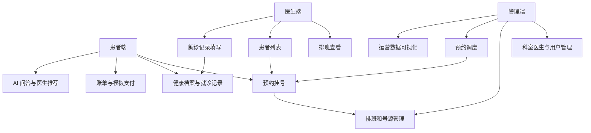
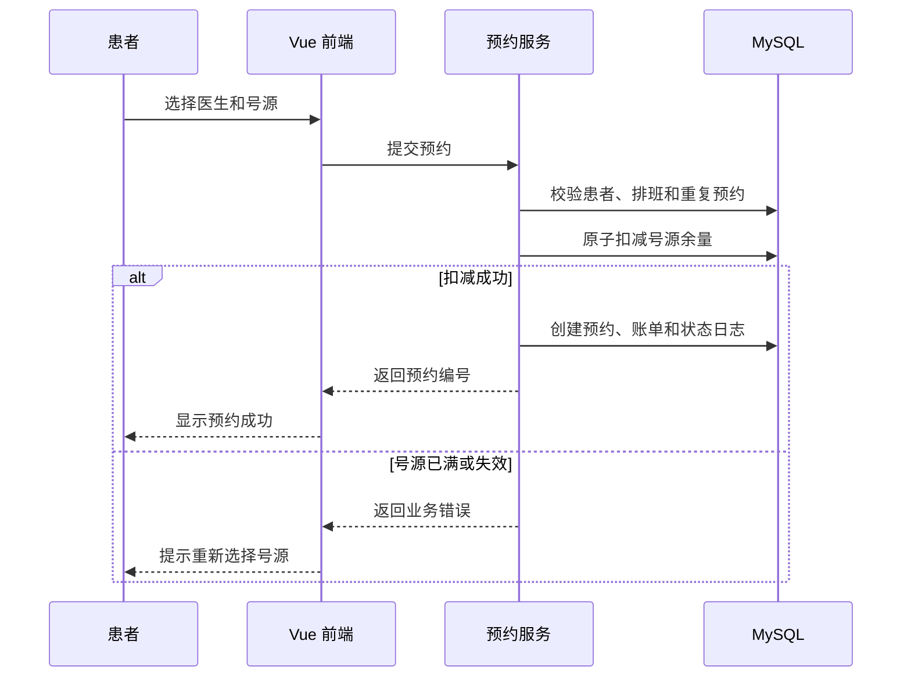

# 设计思路

## 1. 项目概述

### 1.1 项目名称

基于 Spring Boot 的口腔医院预约挂号系统。

### 1.2 建设目标

系统面向患者、医生和医院管理员三类用户，围绕“查询医生—选择号源—提交预约—到院就诊—记录诊疗—支付评价”的完整流程展开，实现预约挂号、医生排班、就诊记录、账单管理、智能问答、医生推荐和运营数据分析。

系统重点解决以下问题：

- 患者难以及时了解科室、医生、出诊时间和剩余号源。
- 人工挂号容易出现重复登记、号源超卖、排班冲突和信息更新不及时。
- 医生难以统一查看当日患者和历史就诊情况。
- 管理员缺少对预约量、号源利用率、取消率和医生工作量的直观统计。
- 普通患者不了解口腔科室和就诊流程，需要基础的问答与分诊提示。

### 1.3 项目边界

本系统定位为毕业设计中的预约挂号与就诊信息管理平台，不替代医院正式的电子病历、处方、医保结算和医疗诊断系统。

- AI 问答只提供口腔健康常识、科室选择和就医流程提示，不输出确定性诊断或处方。
- 支付模块默认采用模拟支付流程，保留对接真实支付平台的接口，不在毕业设计中处理真实资金。
- 就诊记录用于展示预约后的诊疗结果和复诊建议，不扩展到完整电子病历标准。
- 管理员负责业务配置和运营管理，但默认无权随意查看患者的详细病情内容。

## 2. 技术方案

### 2.1 技术栈

结合开题 PPT 中的技术路线，系统采用前后端分离架构。

| 层次 | 技术 | 主要用途 |
| --- | --- | --- |
| 前端 | Vue、Vue Router、Axios、Element UI | 页面展示、路由、接口请求和表单交互 |
| 图表 | ECharts | 管理端运营数据可视化 |
| 后端 | Java 8、Spring Boot 2.3 | REST 接口、业务逻辑和系统配置 |
| 持久层 | MyBatis-Plus | 数据增删改查、分页和条件查询 |
| 权限 | Spring Security 或拦截器 + JWT | 登录认证、角色鉴权和接口保护 |
| 数据库 | MySQL 5.7 | 用户、排班、预约、就诊记录和账单等业务数据 |
| 构建与运行 | Maven、Tomcat | 依赖管理、项目构建和服务运行 |
| 开发工具 | IntelliJ IDEA、Navicat | 编码和数据库管理 |

### 2.2 系统分层

后端按职责划分为 Controller、Service、Mapper 和 Entity/DTO 层。

- Controller：接收请求、校验参数、调用业务服务并返回统一结果。
- Service：实现预约、取消、排班、支付和推荐等核心业务规则，事务控制放在此层。
- Mapper：通过 MyBatis-Plus 访问 MySQL，不在 Controller 中直接拼接 SQL。
- Entity：对应数据库表；DTO/VO 用于接收参数和返回页面数据，避免直接暴露实体对象。
- Common：统一响应、异常处理、JWT、权限注解、日志、分页和枚举。

前端按患者端、医生端和管理端组织页面，并通过路由守卫检查登录状态和角色权限。三个角色可以共用登录页和基础组件，但菜单、首页和数据范围互相隔离。

### 2.3 总体业务结构



## 3. 用户角色与权限

| 角色 | 主要权限 | 数据范围 |
| --- | --- | --- |
| 患者 | 注册登录、查询科室医生、预约、取消、查看个人就诊记录和账单、评价、AI 问答 | 只能访问本人数据 |
| 医生 | 查看个人排班和预约患者、维护个人简介、登记接诊结果、查看本人接诊患者的必要信息 | 只能访问与本人排班或就诊相关的数据 |
| 管理员 | 管理科室、医生、患者账号、排班、号源、预约和系统配置，查看脱敏统计数据 | 医院管理范围内的数据 |

权限实现采用“角色权限 + 数据权限”两层控制。接口通过角色判断能否调用，Service 层继续校验数据归属。例如，患者即使修改 URL 中的预约编号，也不能查询其他患者的预约；医生不能填写不属于自己号源的就诊记录。

## 4. 患者端模块

### 4.1 注册与登录

#### 需求

- 患者使用手机号或用户名注册，填写姓名、性别、出生日期和联系方式。
- 登录成功后获得访问令牌，进入患者首页。
- 支持退出登录、修改密码和忘记密码。毕业设计版本可使用验证码模拟值，接口结构保留真实短信验证扩展能力。
- 身份证号、手机号等敏感字段在页面中脱敏显示。

#### 实现方式

1. 注册时校验用户名和手机号唯一性，密码必须达到最小长度。
2. 后端使用 BCrypt 对密码加密，数据库不保存明文密码。
3. 登录成功后生成 JWT，令牌中只保存用户编号、角色和过期时间。
4. 前端将令牌附加到 Axios 请求头，路由守卫在进入受保护页面前检查登录状态。
5. 后端拦截器解析令牌，将当前用户信息写入请求上下文，并在接口结束后清理。
6. 连续多次登录失败时短时间限制登录，防止简单暴力破解。

#### 核心数据与接口

- 数据表：`sys_user`、`patient_profile`、`login_log`。
- 接口示例：`POST /api/auth/register`、`POST /api/auth/login`、`PUT /api/patient/password`、`GET /api/patient/profile`。

### 4.2 科室、医生与号源查询

#### 需求

- 按口腔科室、医生姓名、职称、擅长方向和出诊日期查询医生。
- 展示医生简介、擅长项目、门诊费用、患者评分、近期可预约日期和剩余号源。
- 支持查看科室说明，帮助患者判断应选择口腔内科、口腔外科、正畸科、修复科等科室。

#### 实现方式

1. 科室和医生资料由管理员维护，医生可以补充个人简介，关键信息变更由管理员确认。
2. 列表查询使用 MyBatis-Plus 分页，避免一次加载全部医生。
3. 号源查询以 `schedule_slot` 为准，只返回状态正常、日期未过期且剩余数量大于零的时段。
4. 医生评分从已完成预约的有效评价中计算，保留一位小数；无评价时显示“暂无评分”，不显示 0 分。
5. 医生详情页只展示业务所需信息，不返回账号密码、手机号等内部字段。

#### 核心数据与接口

- 数据表：`department`、`doctor_profile`、`schedule`、`schedule_slot`、`review`。
- 接口示例：`GET /api/departments`、`GET /api/doctors`、`GET /api/doctors/{id}`、`GET /api/doctors/{id}/slots`。

### 4.3 预约挂号

#### 需求

- 患者选择科室、医生、日期和具体时间段后提交预约。
- 提交前确认就诊人、症状简述、预约费用和就诊时间。
- 系统生成唯一预约编号，患者可在“我的预约”中查看进度。
- 支持预约成功、待就诊、已签到、就诊中、已完成、已取消、爽约等状态。
- 防止同一号源超卖、患者重复预约和医生同一时间重复排班。

#### 实现方式

1. 前端提交 `slotId`、症状简述和就诊人编号，不接收前端传入的医生名称、价格或号源余量作为可信数据。
2. 后端在事务中重新查询号源状态，并使用原子更新扣减余量：

   ```sql
   UPDATE schedule_slot
   SET remaining = remaining - 1,
       version = version + 1
   WHERE id = #{slotId}
     AND remaining > 0
     AND status = 'AVAILABLE';
   ```

3. 只有更新影响行数为 1 时才创建预约记录，否则返回“号源已满或已失效”。此方式可避免并发请求造成超卖。
4. 数据库增加患者与时间段的唯一约束，服务层同时检查患者在同一时间是否已有未取消预约。
5. 使用客户端请求号或幂等键防止用户快速重复点击产生两笔预约。
6. 预约成功后生成预约编号和待支付账单，并写入系统通知。
7. 预约列表按状态和日期筛选；默认显示未完成预约，历史记录单独分页查询。

#### 业务规则

- 只能预约当前时间之后且处于开放状态的号源。
- 每个患者每天最多预约指定数量，数量由系统参数配置。
- 同一患者不能预约时间重叠的两个号源。
- 停诊或排班变更时，受影响预约进入“待处理”队列，由管理员改约或取消并通知患者。
- 预约状态变更必须写入 `appointment_status_log`，保留操作人、变更前后状态和时间。

#### 核心数据与接口

- 数据表：`appointment`、`appointment_status_log`、`schedule_slot`、`system_message`。
- 接口示例：`POST /api/appointments`、`GET /api/patient/appointments`、`GET /api/appointments/{id}`。

### 4.4 取消预约与改约

#### 需求

- 患者在规定时间前取消预约，并查看取消结果。
- 支持在有剩余号源时改约，避免先取消后无法重新预约。
- 已签到、就诊中或已完成的预约不能由患者自行取消。

#### 实现方式

1. 后端校验预约属于当前患者，并判断预约状态和取消截止时间。
2. 取消操作在同一事务中完成预约状态变更、号源余量恢复和账单关闭或退款状态更新。
3. 改约采用一个事务：先锁定新号源并扣减余量，再释放原号源，最后更新预约时间。任一步失败则整体回滚。
4. 取消原因使用字典选项加补充说明，管理员可统计主要取消原因。
5. 重复取消直接返回当前结果，不重复增加号源数量。

#### 接口示例

- `PUT /api/appointments/{id}/cancel`
- `PUT /api/appointments/{id}/reschedule`

### 4.5 就诊记录与健康档案

#### 需求

- 患者可维护过敏史、既往史和基础健康信息。
- 患者可查看医生完成的主诉、初步检查结果、处理项目、医嘱和复诊建议。
- 支持按日期、医生和科室查询历史就诊记录。
- 记录只读展示，患者不能修改医生填写的诊疗内容。

#### 实现方式

1. 患者档案与医生就诊记录分表保存，避免个人基本信息与诊疗内容混杂。
2. 医生完成接诊后生成 `medical_record`，记录与预约一一关联，保证来源可追溯。
3. 医疗附件只保存文件地址、类型、大小和上传者，文件名使用随机编号，禁止执行型文件上传。
4. 查询就诊记录时校验当前用户身份。患者只能看本人记录，医生只能看本人接诊或当前预约需要的记录。
5. 重要修改保留版本或修改日志，不直接覆盖而不留痕。

#### 核心数据与接口

- 数据表：`patient_profile`、`health_archive`、`medical_record`、`medical_attachment`、`record_change_log`。
- 接口示例：`GET /api/patient/medical-records`、`GET /api/medical-records/{id}`、`PUT /api/patient/health-archive`。

### 4.6 支付与账单

#### 需求

- 患者查看挂号费、诊疗项目费用和账单状态。
- 对待支付账单执行模拟支付，查看支付结果和支付时间。
- 取消符合条件的预约后支持模拟退款。

#### 实现方式

1. 预约成功时由后端根据号源配置生成账单金额，不能使用前端提交的金额。
2. 账单状态设置为待支付、已支付、退款中、已退款、已关闭。
3. 支付请求包含唯一支付流水号。即使前端重复提交，后端也只能将同一账单成功支付一次。
4. 模拟支付接口按照真实支付回调思路实现：校验订单、校验金额、更新账单、写支付流水，全部放入事务。
5. 金额字段使用 `DECIMAL`，Java 使用 `BigDecimal`，不使用浮点数计算金额。
6. 后续若接入真实平台，只需替换支付服务实现，并增加签名验证和异步回调接口。

#### 核心数据与接口

- 数据表：`bill`、`payment_record`、`refund_record`。
- 接口示例：`GET /api/patient/bills`、`POST /api/bills/{id}/mock-pay`、`GET /api/bills/{id}`。

### 4.7 AI 问答助手

#### 需求

- 回答口腔科室选择、预约流程、就诊准备和常见口腔健康知识。
- 对“牙疼应该挂什么科”等问题给出初步分诊提示。
- 保存患者本人的会话历史，允许新建会话和删除历史。
- 对急症关键词给出及时就医提示，不延误线下治疗。

#### 实现方式

AI 问答采用“审核知识库优先，模型补充表达”的方式，控制回答范围。

1. 管理员维护经过审核的常见问题、科室说明和就诊须知。
2. 系统先对问题进行关键词和相似度匹配，命中常见问题时直接返回标准答案。
3. 未命中时可调用外部大模型接口，并在系统提示词中限定其只回答口腔健康和医院流程问题。
4. 输入发送给外部模型前移除姓名、手机号、身份证号等身份信息，不将完整病历直接发送给第三方。
5. 对“大量出血、呼吸困难、颌面部严重外伤、高热伴肿胀”等内容返回急诊或立即线下就医提示。
6. 每个回答固定展示“仅供健康咨询参考，不能替代医生面诊”的提示。
7. 保存问题、回答来源、耗时和反馈结果，便于管理员改进知识库；不记录无关敏感信息。
8. 当模型接口超时或不可用时，降级返回常见问题搜索结果和人工就医提示。

#### 核心数据与接口

- 数据表：`ai_session`、`ai_message`、`knowledge_item`、`ai_feedback`。
- 接口示例：`POST /api/ai/chat`、`GET /api/ai/sessions`、`DELETE /api/ai/sessions/{id}`。

### 4.8 个性化医生推荐

#### 需求

- 根据患者选择的科室、历史预约、医生评分和近期号源推荐合适医生。
- 新用户没有历史数据时也能得到合理结果。
- 推荐结果说明主要原因，例如“擅长正畸且本周有号”。

#### 实现方式

毕业设计阶段采用可解释的加权评分，不依赖复杂机器学习模型。

```text
推荐得分 = 科室或擅长匹配度 × 40%
         + 近期可预约程度 × 25%
         + 医生有效评分 × 20%
         + 患者历史偏好 × 15%
```

1. 患者主动选择的科室和症状关键词用于计算擅长匹配度。
2. 未来七天可预约时段越多，可预约得分越高。
3. 评分只统计已完成就诊后的有效评价，并设置最小评价数量，避免一条评价造成极端排名。
4. 历史偏好只使用患者已完成的科室和医生记录，不使用与推荐无关的敏感信息。
5. 新用户采用科室匹配、近期有号和综合评分排序。
6. 推荐接口返回得分构成和推荐理由，便于论文展示算法可解释性。
7. 管理员不能付费干预推荐排序；停诊或无号医生不进入结果。

#### 核心数据与接口

- 数据来源：`doctor_profile`、`schedule_slot`、`appointment`、`review`。
- 可选缓存表：`doctor_recommend_snapshot`。
- 接口示例：`GET /api/recommend/doctors?departmentId=...`。

### 4.9 个人中心、评价与反馈

#### 需求

- 修改头像、联系方式和健康档案，查看个人预约、账单、收藏和消息。
- 患者在就诊完成后对医生进行评分和文字评价。
- 提交系统意见或投诉，并查看处理状态。

#### 实现方式

1. 只有状态为“已完成”的预约可以评价，每个预约只能评价一次。
2. 评价包含服务态度、沟通情况、总体评分和文字内容，可选择匿名展示。
3. 评价发布前进行长度、敏感词和空内容校验；管理员只能屏蔽违规内容，不能修改患者原文。
4. 医生综合评分采用有效评价实时计算或定时汇总。
5. 意见反馈设置待处理、处理中、已回复和已关闭状态，回复后通过站内消息通知患者。

#### 核心数据与接口

- 数据表：`review`、`feedback`、`favorite_doctor`、`system_message`。
- 接口示例：`POST /api/appointments/{id}/review`、`POST /api/feedback`、`GET /api/patient/messages`。

## 5. 医生端模块

### 5.1 登录与个人信息管理

#### 需求与实现

- 医生账号由管理员创建或审核，避免普通用户自行注册为医生。
- 医生可维护头像、简介、擅长方向和出诊说明；姓名、工号、职称、所属科室等关键字段由管理员维护。
- 医师资格证明等附件仅管理员可查看，不在患者端公开。
- 医生首页展示今日出诊时段、预约人数、待接诊人数和需要复诊关注的患者。

核心表为 `sys_user`、`doctor_profile`、`doctor_qualification`，接口包括 `GET /api/doctor/profile` 和 `PUT /api/doctor/profile`。

### 5.2 排班管理

#### 需求

- 医生查看日历形式的个人排班、号源数量和预约情况。
- 医生可提交请假或停诊申请；正式排班由管理员发布。
- 对已有预约的排班不能直接删除。

#### 实现方式

1. 排班由日期、班次、开始时间、结束时间、诊室、总号源和挂号费组成。
2. 发布排班前校验医生时间冲突、诊室冲突和日期有效性。
3. 排班发布后按固定间隔拆分为 `schedule_slot`，例如每 30 分钟一个时段，并为每个时段设置容量。
4. 已产生预约后只允许减少未预约的剩余容量，不能把总容量调到已预约数量以下。
5. 医生请假生成申请，管理员审核后执行停诊和预约处理，保证患者收到通知。

核心表为 `schedule`、`schedule_slot`、`leave_request`，接口包括 `GET /api/doctor/schedules` 和 `POST /api/doctor/leave-requests`。

### 5.3 患者与预约列表

#### 需求与实现

- 医生按日期查看本人预约患者，支持按预约编号、患者姓名和状态筛选。
- 列表显示预约时间、症状简述、签到状态和历史就诊次数。
- 医生可执行叫号、开始接诊和完成接诊，状态必须按顺序流转。
- 医生只能查看当前诊疗所需信息。对非本人患者的查询直接拒绝并记录异常访问日志。
- 对爽约患者可在过号规则到达后标记爽约，系统保留操作记录。

核心接口包括 `GET /api/doctor/appointments`、`PUT /api/doctor/appointments/{id}/call` 和 `PUT /api/doctor/appointments/{id}/start`。

### 5.4 就诊记录管理

#### 需求

- 医生填写主诉、检查结果、初步判断、处理项目、医嘱和建议复诊日期。
- 支持暂存和正式提交，避免一次未写完就锁定记录。
- 正式提交后患者可以查看，修改需要填写原因并保留痕迹。

#### 实现方式

1. 只有预约状态为已签到或就诊中的记录可以创建就诊内容。
2. 草稿归当前医生所有；正式提交时校验必填字段，并将预约改为已完成。
3. `medical_record` 保存当前版本，`medical_record_version` 保存历史版本和修改原因。
4. 就诊完成后按诊疗项目生成或补充账单项目，并生成复诊提醒。
5. 就诊记录内容按纯文本或受控富文本保存，后端过滤脚本标签，防止 XSS。

核心接口包括 `POST /api/doctor/medical-records/draft`、`PUT /api/doctor/medical-records/{id}/submit` 和 `GET /api/doctor/patients/{id}/history`。

### 5.5 评价与反馈查看

#### 需求与实现

- 医生查看本人收到的评价、评分趋势和患者意见。
- 医生可以对评价作一次公开回复，但不能删除或修改患者内容。
- 争议评价可提交管理员复核，管理员根据规则屏蔽违规内容并记录原因。
- 统计结果不展示患者敏感信息，匿名评价不向医生暴露患者身份。

核心接口包括 `GET /api/doctor/reviews`、`POST /api/doctor/reviews/{id}/reply` 和 `POST /api/doctor/reviews/{id}/appeal`。

## 6. 管理端模块

### 6.1 管理首页

管理首页展示当天预约数、待就诊数、已完成数、取消数、当前开放号源、号源利用率和待处理事项。页面只展示汇总信息，点击指标后进入对应业务列表。

实现时由后端提供一个聚合接口，避免前端为每个指标发送独立请求。统计查询可按天缓存，实时性要求高的当日数据直接从预约表聚合。

接口示例：`GET /api/admin/dashboard/summary`。

### 6.2 用户、医生与科室管理

#### 需求

- 管理患者账号、医生账号和管理员账号，支持查询、启用、禁用和重置密码。
- 管理科室名称、介绍、排序和启用状态。
- 维护医生工号、科室、职称、擅长方向、挂号费和审核状态。

#### 实现方式

1. 删除业务用户采用逻辑删除或禁用，避免历史预约失去关联。
2. 禁用账号前提示其未完成预约；医生停用时必须先处理未来排班。
3. 角色变更属于高风险操作，写入管理员操作日志。
4. 列表支持分页、组合筛选和脱敏展示，导出时再次检查权限。
5. 科室停用后不再接受新排班，但保留历史记录。

核心表为 `sys_user`、`sys_role`、`user_role`、`department`、`doctor_profile` 和 `admin_operation_log`。

### 6.3 排班与号源管理

#### 需求

- 按医生、科室、日期批量创建和发布排班。
- 设置诊室、时段、号源量和挂号费用。
- 检查医生冲突、诊室冲突，处理停诊和临时加号。

#### 实现方式

1. 新排班先保存为草稿，校验通过后发布，发布后才对患者可见。
2. 批量排班可使用模板复制，但生成时逐日检查节假日、医生请假和冲突。
3. 数据库为医生、开始时间、结束时间建立索引；Service 层检查时间区间是否相交。
4. 临时加号只能增加容量，减少容量不得低于已预约数量。
5. 停诊时列出受影响患者，由管理员选择改约或取消，系统批量发送站内通知。

接口示例：`POST /api/admin/schedules`、`PUT /api/admin/schedules/{id}/publish`、`POST /api/admin/schedules/{id}/suspend`。

### 6.4 预约管理与现场调度

#### 需求

- 按日期、科室、医生、患者和状态查询全部预约。
- 为线下患者补录预约，处理签到、取消、改约、爽约和异常订单。
- 查看每次状态变更和操作人员。

#### 实现方式

1. 管理员操作仍复用统一的预约领域服务，不能通过后台直接修改数据库状态。
2. 强制取消、改约等操作必须填写原因，并通知患者。
3. 签到可通过预约编号或二维码完成，后端校验预约日期和当前状态。
4. 列表页显示清晰的状态标签，危险操作二次确认。
5. 所有人工干预写入 `appointment_status_log` 和 `admin_operation_log`。

接口示例：`GET /api/admin/appointments`、`PUT /api/admin/appointments/{id}/check-in`、`PUT /api/admin/appointments/{id}/reschedule`。

### 6.5 数据可视化

#### 统计指标

- 预约趋势：按日、周、月统计预约总量和完成量。
- 科室分布：各科室预约数量及占比。
- 号源利用率：已预约数量除以发布号源总量。
- 取消率和爽约率：取消或爽约数量除以有效预约数量。
- 医生工作量：接诊数量、排班时长和平均评分。
- 时段热度：不同日期和时间段的预约数量。
- 患者复诊情况：一定周期内再次就诊的人数，只展示汇总数据。

#### 实现方式

1. ECharts 展示折线图、柱状图和饼图，图表支持日期、科室和医生筛选。
2. 后端统一计算指标口径，前端只负责展示，避免不同页面计算结果不一致。
3. 数据量较小时直接使用 SQL `GROUP BY` 聚合；数据量增加后通过定时任务写入 `daily_statistics`。
4. 报表不展示患者姓名、手机号或病历正文。
5. 导出 CSV/Excel 时记录导出人、筛选条件和时间，并限制可导出的字段。

接口示例：`GET /api/admin/statistics/appointments`、`GET /api/admin/statistics/departments`、`GET /api/admin/statistics/doctors`。

### 6.6 知识库、通知与系统配置

管理员维护 AI 常见问题、科室说明、预约须知、取消截止时间、每日预约上限和消息模板。配置项保存时进行类型和范围校验，关键参数修改写入操作日志。

消息通知至少支持站内消息：预约成功、改约、取消、停诊、就诊前提醒、支付结果和反馈回复。定时任务每天扫描次日预约并生成提醒。短信或邮件作为可选扩展，发送失败不影响预约主流程，但需要记录失败原因并允许重试。

## 7. 核心业务流程

### 7.1 在线预约流程



### 7.2 到院就诊流程

1. 患者凭预约编号签到，预约从“待就诊”变为“已签到”。
2. 医生查看候诊列表并叫号，将患者状态改为“就诊中”。
3. 医生填写就诊记录，可先暂存草稿。
4. 医生正式提交记录，预约变为“已完成”，患者可以查看医嘱。
5. 系统根据诊疗项目更新账单，并在需要时创建复诊提醒。
6. 患者完成支付后可以提交评价。

### 7.3 预约状态设计

```text
待支付 -> 待就诊 -> 已签到 -> 就诊中 -> 已完成
   |          |          |
   +-------> 已取消 <----+
              |
           已退款

待就诊 -> 爽约
排班停诊 -> 待处理 -> 已改约 / 已取消
```

状态流转在后端通过枚举和状态校验统一控制。前端按钮只决定“是否显示”，不能代替后端权限和状态判断。

## 8. 数据库设计

### 8.1 主要数据表

| 表名 | 关键字段 | 说明 |
| --- | --- | --- |
| `sys_user` | id、username、password、phone、role、status | 统一账号信息 |
| `patient_profile` | user_id、name、gender、birthday | 患者基本资料 |
| `doctor_profile` | user_id、department_id、title、specialty、fee | 医生资料 |
| `department` | name、description、status、sort | 口腔科室 |
| `schedule` | doctor_id、date、start_time、end_time、room、status | 医生排班 |
| `schedule_slot` | schedule_id、start_time、end_time、capacity、remaining、version | 可预约时段和余量 |
| `appointment` | appointment_no、patient_id、doctor_id、slot_id、status | 预约主表 |
| `appointment_status_log` | appointment_id、before_status、after_status、operator_id、reason | 状态轨迹 |
| `health_archive` | patient_id、allergy_history、past_history | 患者健康档案 |
| `medical_record` | appointment_id、doctor_id、chief_complaint、examination、advice | 就诊记录 |
| `bill` | bill_no、appointment_id、amount、status | 账单 |
| `payment_record` | payment_no、bill_id、amount、pay_time、status | 支付流水 |
| `review` | appointment_id、patient_id、doctor_id、score、content | 就诊评价 |
| `feedback` | user_id、type、content、status、reply | 意见反馈 |
| `ai_session` | patient_id、title、created_at | AI 会话 |
| `ai_message` | session_id、role、content、source | AI 消息 |
| `knowledge_item` | category、question、answer、status | 审核知识库 |
| `system_message` | receiver_id、type、title、content、read_status | 站内通知 |
| `admin_operation_log` | operator_id、module、action、target_id、result | 管理操作审计 |

### 8.2 关键约束与索引

- `sys_user.username`、`sys_user.phone` 设置唯一索引。
- `appointment.appointment_no`、`bill.bill_no`、`payment_record.payment_no` 设置唯一索引。
- `appointment` 对患者编号、时段编号和有效状态建立组合索引，便于重复预约检查。
- `schedule` 对医生、日期、开始时间建立索引。
- `schedule_slot` 保留 `remaining >= 0` 的业务校验，所有增减必须在事务中执行。
- `review.appointment_id` 设置唯一约束，保证一次预约只能评价一次。
- 业务表统一包含 `created_at`、`updated_at`，需要逻辑删除的表增加 `deleted` 字段。

## 9. 接口与前端页面组织

### 9.1 统一接口规范

接口统一返回以下结构：

```json
{
  "code": 0,
  "message": "success",
  "data": {}
}
```

- `code = 0` 表示成功，其他值表示明确的业务错误。
- 分页结果统一返回 `records`、`total`、`current` 和 `size`。
- 使用 `@Valid` 校验请求参数，使用全局异常处理器转换参数错误、权限错误和业务异常。
- 预约已满、状态不允许、重复预约等情况使用可读的业务提示，不把数据库异常直接返回前端。

### 9.2 页面规划

#### 患者端

- 首页与科室导航
- 医生列表与医生详情
- 日期及号源选择
- 预约确认与结果
- 我的预约
- 就诊记录与健康档案
- 账单与模拟支付
- AI 问答
- 推荐医生
- 消息、评价与个人中心

#### 医生端

- 工作台
- 我的排班
- 今日患者与历史患者
- 就诊记录编辑
- 复诊提醒
- 评价与反馈
- 个人信息

#### 管理端

- 数据概览
- 科室管理
- 医生与患者管理
- 排班和号源管理
- 预约管理
- 账单查询
- 数据可视化
- AI 知识库
- 反馈、通知、系统配置和操作日志

## 10. 安全与非功能需求

### 10.1 安全要求

- 密码使用 BCrypt 加密，敏感配置通过环境变量或配置文件外置，不提交真实密钥。
- 所有查询和更新都使用参数化 SQL，禁止字符串拼接查询条件。
- 富文本和用户输入在后端过滤，前端输出时转义，防止 XSS。
- JWT 设置有效期，退出登录后可通过令牌版本或黑名单使旧令牌失效。
- 敏感字段在接口返回、日志和导出文件中脱敏。
- 上传文件校验后缀、MIME 类型和大小，并存放在不可执行目录。
- 管理员的用户禁用、排班变更、强制取消和数据导出必须写审计日志。
- 数据库定期备份，恢复演练至少验证用户、排班、预约和病历数据可恢复。

### 10.2 性能要求

- 普通列表查询使用分页，常用筛选字段建立索引。
- 医生列表、科室列表和未来号源可短时间缓存，预约余量以数据库实时结果为准。
- 统计报表与在线预约业务分开处理，复杂统计不占用预约事务。
- 外部 AI 调用设置连接和读取超时，失败时降级，不拖慢其他业务接口。
- 短信、提醒和统计汇总通过异步任务或定时任务执行。

### 10.3 可用性要求

- 表单明确标注必填项，日期和时段使用选择控件，减少输入错误。
- 预约、取消、支付等关键操作提供二次确认和清晰结果页。
- 页面同时提供颜色和文字状态，不能只用颜色区分。
- 手机端保证基础自适应，患者可以完成查询、预约、取消和查看记录。
- 后端错误返回业务描述和追踪编号，前端不显示堆栈信息。

## 11. 测试与验收

### 11.1 核心测试场景

| 模块 | 必测场景 | 预期结果 |
| --- | --- | --- |
| 登录 | 密码错误、禁用账号、令牌过期 | 拒绝访问并返回明确提示 |
| 预约 | 多个用户同时抢最后一个号源 | 只有一个预约成功，余量不为负数 |
| 重复提交 | 连续点击两次预约或支付 | 只生成一条有效业务记录 |
| 取消 | 重复取消、超过截止时间取消 | 不重复释放号源，超时取消被拒绝 |
| 改约 | 新号源扣减失败 | 原预约和原号源保持不变 |
| 排班 | 医生或诊室时间重叠 | 系统阻止发布 |
| 病历 | 患者访问他人记录 | 返回无权限，不泄露数据 |
| 评价 | 未完成预约提交评价 | 系统拒绝；完成后只能评价一次 |
| AI | 模型超时、输入急症关键词 | 降级回答或给出及时就医提示 |
| 报表 | 相同筛选条件重复查询 | 指标口径和明细数量一致 |

### 11.2 验收标准

- 三类角色能够登录并进入各自菜单，越权接口全部被拦截。
- 患者能够完成医生查询、预约、模拟支付、取消、记录查看和评价闭环。
- 医生能够查看本人排班与患者并完成就诊记录。
- 管理员能够配置科室医生、发布排班、处理预约和查看统计图表。
- 并发预约不会导致号源超卖，异常事务不会留下半完成数据。
- AI 问答具备范围限制、免责声明、急症提示和不可用时的降级方案。
- 核心业务操作均有状态记录或审计日志，可以追踪问题来源。

## 12. 推荐开发顺序

1. 完成用户、角色、科室和医生的数据表及登录权限。
2. 完成排班、号源查询和预约并发控制，先打通最核心闭环。
3. 完成取消、改约、签到和预约状态日志。
4. 完成医生工作台、患者列表和就诊记录。
5. 完成账单、模拟支付、评价、反馈和站内消息。
6. 完成管理端统计接口与 ECharts 图表。
7. 在基础业务稳定后接入 AI 问答和医生推荐，避免智能模块影响主流程开发。
8. 完成权限、异常、日志、备份和并发测试，整理测试截图与论文材料。

## 13. 可作为毕业设计亮点的内容

- 使用原子更新和事务控制解决热门号源并发超卖问题，能够在论文中展示具体方案和测试结果。
- 使用可解释加权算法完成医生推荐，给出推荐得分组成，便于实现和答辩说明。
- AI 问答采用审核知识库、模型调用、急症识别和失败降级组合方案，兼顾功能效果与医疗安全边界。
- 通过预约状态日志、病历版本和管理员审计日志实现业务可追溯。
- 通过号源利用率、取消率、爽约率和时段热度等指标支持医院排班优化，体现数据驱动管理价值。

以上方案以预约挂号主流程为核心，将智能问答和推荐作为增强功能。开发时应优先保证登录权限、排班号源、预约事务和就诊记录正确，再逐步增加图表和智能能力。
